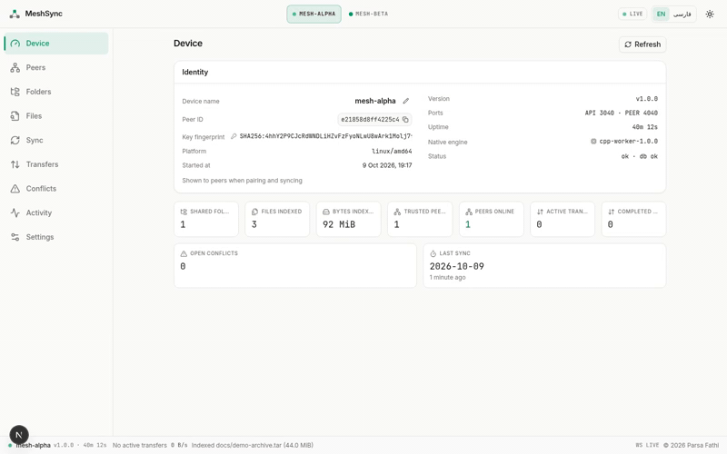

# MeshSync Quickstart

A five-minute, two-device demo on one machine. Two agents, real pairing,
real chunked transfer over TLS. Prerequisites: Go 1.25+ built agent; a
second terminal; curl.

What the whole flow looks like in the web console (plan → live transfer
progress → synced):



```sh
# 0. build the agent (once)
cd agent
go build -o ../meshsync-agent ./cmd/meshsync-agent
cd ..
```

## 1. Start two agents

```sh
# terminal 1 — device A
./meshsync-agent --name mesh-alpha --api-port 3040 --peer-port 4040 \
  --data-dir ~/.meshsync-a

# terminal 2 — device B
./meshsync-agent --name mesh-beta --api-port 3041 --peer-port 4041 \
  --data-dir ~/.meshsync-b
```

Each prints its peer ID and listening address. Check health:

```sh
curl -s http://127.0.0.1:3040/api/v1/health
curl -s http://127.0.0.1:3041/api/v1/health
```

## 2. Pair the devices

```sh
# A asks B to pair (learns B's key from the TLS handshake)
curl -s -X POST http://127.0.0.1:3040/api/v1/peers/pair \
  -H 'Content-Type: application/json' -d '{"address":"127.0.0.1:4041"}'

# find A's peerId as seen by B
curl -s http://127.0.0.1:3041/api/v1/peers

# B approves (use the real peerId from above)
curl -s -X POST http://127.0.0.1:3041/api/v1/peers/<A-PEER-ID>/approve
```

Both peers now show `"trust": "TRUSTED"` in `GET /api/v1/peers` on either
side. (Discovery beacons also work: `curl -s -X POST
http://127.0.0.1:3041/api/v1/discovery/scan` records A as `DISCOVERED` —
discovery never trusts, pairing does.)

## 3. Share a folder (same name on both sides)

```sh
mkdir -p ~/meshsync/shared-a ~/meshsync/shared-b
echo "hello from A" > ~/meshsync/shared-a/notes.txt

curl -s -X POST http://127.0.0.1:3040/api/v1/shared-folders \
  -H 'Content-Type: application/json' \
  -d '{"name":"Documents","path":"'$HOME'/meshsync/shared-a"}'

curl -s -X POST http://127.0.0.1:3041/api/v1/shared-folders \
  -H 'Content-Type: application/json' \
  -d '{"name":"Documents","path":"'$HOME'/meshsync/shared-b"}'
```

## 4. Plan, then sync

```sh
B_PEER_ID=$(curl -s http://127.0.0.1:3040/api/v1/peers | sed -E 's/.*"peerId": "([0-9a-f]+)".*/\1/')

# dry run: see what would move, nothing is touched
curl -s "http://127.0.0.1:3040/api/v1/sync/plan?peer=$B_PEER_ID&folder=1"

# execute
curl -s -X POST http://127.0.0.1:3040/api/v1/sync/run \
  -H 'Content-Type: application/json' -d "{\"peer\":\"$B_PEER_ID\",\"folder\":1}"

# watch what happened
curl -s "http://127.0.0.1:3040/api/v1/events?limit=20"
```

The file is now in `~/meshsync/shared-b/notes.txt` — transferred in
verified 1 MiB chunks and hash-checked before landing.

## 5. Verify the round trip

```sh
cat ~/meshsync/shared-b/notes.txt          # "hello from A"
echo "edited on B" > ~/meshsync/shared-b/notes.txt
# sync from B this time (A's peerId as seen from B)
curl -s -X POST http://127.0.0.1:3041/api/v1/sync/run \
  -H 'Content-Type: application/json' -d "{\"peer\":\"<A-PEER-ID>\",\"folder\":1}"
cat ~/meshsync/shared-a/notes.txt          # "edited on B"
```

Edit the file on *both* sides before the next sync to see a `CONFLICT`
appear in `GET /api/v1/conflicts` and resolve it with `KEEP_LOCAL`,
`KEEP_REMOTE`, `KEEP_BOTH`, or `LATER`.

## Notes

- The automated equivalent of this whole page lives in the repo scripts:
  `scripts/run-agents.sh` (starts/stops the two agents with state under
  `.runtime/`) and `scripts/demo-sync.sh` (pairs, shares folders, syncs, and
  verifies transferred hashes — prints PASS/FAIL).
- Behind the sandbox gateway (port 81) every request carries the target
  port as a query parameter instead:
  `curl -s "http://<host>:81/api/v1/peers?XTransformPort=3040"`.
- The web console offers the same flow visually: `bun run dev`, open
  <http://localhost:3000>, register endpoints 3040 and 3041.
- Optional: build the C++ hashing worker (`cd native/cpp && make`) and pass
  `--native-path ./native/cpp/meshsync-native` for faster hashing of large
  files. Without it the agent hashes in pure Go and emits one
  `NATIVE_FALLBACK` event.

Full reference: [README](../README.md) · [API contract](API.md) ·
[فارسی](fa/README_FA.md).
